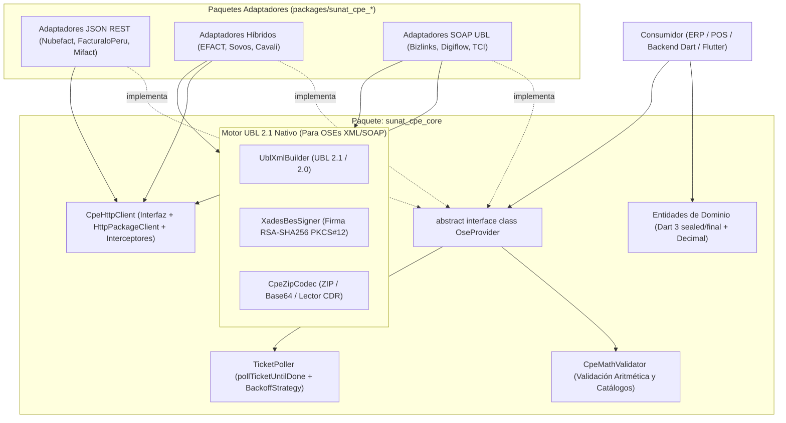

# Arquitectura, Patrones e Interfaces de `sunat_cpe_core`

Especificación de la arquitectura limpia, contratos de proveedores, modelo de resultados/errores y capa de transporte para `sunat_cpe_core`.

---

## 1. Diagrama de Capas y Flujo Híbrido



---

## 2. Patrones de Diseño Aplicados

1. **Strategy + Adapter Pattern (`OseProvider`)**:
   - Unifica 9 APIs heterogéneas (JSON plano, JSON anidado, Multipart CSV/XML, SOAP 1.1 WS-Security) detrás de una única interfaz semántica en Dart.
2. **Template Method (`BaseUblOseProvider` y `BaseRestPseProvider`)**:
   - `BaseUblOseProvider`: Ejecuta el pipeline estándar para OSEs UBL:
     `Validar Matemática -> Generar XML UBL 2.1 -> Firmar XAdES-BES -> Comprimir ZIP (`{RUC}-{TIPO}-{SERIE}-{NUMERO}.zip`) -> Enviar por SOAP/REST -> Extraer `applicationResponse` -> Parsear XML del CDR`.
   - `BaseRestPseProvider`: Ejecuta el pipeline estándar para PSEs JSON:
     `Validar Matemática -> Mapear Entidad a DTO JSON -> Enviar HTTP POST -> Mapear Respuesta JSON a CpeEmissionResponse`.
3. **Railway Oriented Programming + Exception Escape Hatch (`CpeResult<T>`)**:
   - Uso de `sealed class CpeResult<T>` para forzar el manejo exhaustivo con `switch` en Dart 3, combinado con `.getOrThrow()` para código imperativo.
4. **Chain of Responsibility (`CpeHttpInterceptor`)**:
   - Pipeline de interceptores en `CpeHttpClient` para inyectar cabeceras `Authorization`, firmar sobres SOAP `wsse:Security`, registrar trazas XML/JSON y gestionar reintentos ante errores de red transitorios (`502`, `503`, `504`, `SocketException`).

---

## 3. Modelo de Resultados y Errores (`CpeResult<T>`)

SUNAT y los OSE clasifican los eventos en 4 categorías críticas que **no deben mezclarse**:
- **Excepciones (`0100` - `1999`)**: Errores técnicos, de formato ZIP/XML, certificado o indisponibilidad temporal. **El comprobante NO fue registrado**; se puede corregir y reenviar con el mismo correlativo.
- **Rechazos (`2000` - `3999`)**: Errores de negocio definitivos (ej. RUC clausurado, cálculos inválidos en OSE). **El comprobante queda RECHAZADO**; el correlativo queda inutilizado o requiere emitir un nuevo número según la regla específica.
- **Aceptado (`0`)**: Comprobante válido con CDR emitido.
- **Observaciones (`4000`+)**: Advertencias no bloqueantes incluidas dentro de un CDR **Aceptado (`0`)**.

### Definición en Dart 3

```dart
sealed class CpeResult<T> {
  const CpeResult();

  bool get isSuccess => this is CpeSuccess<T>;
  bool get isFailure => this is CpeFailure<T>;

  /// Desempaqueta el resultado exitoso o lanza la CpeException correspondiente.
  T getOrThrow() => switch (this) {
        CpeSuccess<T>(:final data) => data,
        CpeFailure<T>(:final error) => throw error,
      };

  R fold<R>(
    R Function(T data) onSuccess,
    R Function(CpeException error) onFailure,
  ) =>
      switch (this) {
        CpeSuccess<T>(:final data) => onSuccess(data),
        CpeFailure<T>(:final error) => onFailure(error),
      };
}

final class CpeSuccess<T> extends CpeResult<T> {
  final T data;
  final Map<String, dynamic> providerRawMetadata;

  const CpeSuccess(this.data, {this.providerRawMetadata = const {}});
}

final class CpeFailure<T> extends CpeResult<T> {
  final CpeException error;
  const CpeFailure(this.error);
}
```

### Jerarquía de Excepciones (`CpeException`)

```dart
sealed class CpeException implements Exception {
  final String message;
  final String? code;
  final Object? rawResponse;
  final StackTrace? stackTrace;

  const CpeException({
    required this.message,
    this.code,
    this.rawResponse,
    this.stackTrace,
  });
}

/// 1. Error local antes de tocar la red (CpeMathValidator o campos faltantes).
final class CpeValidationException extends CpeException {
  final List<ValidationIssue> issues;
  const CpeValidationException({
    required super.message,
    required this.issues,
  }) : super(code: 'LOCAL_VALIDATION_ERROR');
}

/// 2. Error de red, timeout, DNS, TLS o caída HTTP 5xx del proveedor.
final class OseTransportException extends CpeException {
  final int? httpStatusCode;
  final bool isRetryable;
  const OseTransportException({
    required super.message,
    this.httpStatusCode,
    this.isRetryable = true,
    super.code,
    super.rawResponse,
    super.stackTrace,
  });
}

/// 3. Error de autenticación (Token inválido, WS-Security fallido, OAuth2 401/403).
final class OseAuthException extends CpeException {
  const OseAuthException({
    required super.message,
    super.code = 'AUTH_ERROR',
    super.rawResponse,
  });
}

/// 4. Excepción SUNAT/OSE (Códigos 0100 al 1999). NO genera CDR de rechazo; permite reenvío.
final class SunatExceptionError extends CpeException {
  final int sunatCode;
  const SunatExceptionError({
    required this.sunatCode,
    required super.message,
    super.rawResponse,
  }) : super(code: '$sunatCode');
}

/// 5. Rechazo definitivo SUNAT/OSE (Códigos 2000 al 3999). Incluye CDR de rechazo si fue emitido.
final class SunatRejectionException extends CpeException {
  final int sunatCode;
  final CdrData? rejectionCdr;
  const SunatRejectionException({
    required this.sunatCode,
    required super.message,
    this.rejectionCdr,
    super.rawResponse,
  }) : super(code: '$sunatCode');
}
```

---

## 4. Interfaces de Respuesta Unificadas

```dart
enum CpeProcessStatus {
  accepted,            // Código 0 sin observaciones
  acceptedWithWarnings,// Código 0 con códigos 4000+
  inProcess,           // En cola / Ticket pendiente (Código 98 en SUNAT / PSE diferido)
  rejected,            // Rechazado (2000-3999)
}

final class SunatWarning {
  final String code;        // Ej: "4252"
  final String description;
  const SunatWarning({required this.code, required this.description});
}

final class CdrData {
  final String id;                   // ID del ApplicationResponse
  final String responseCode;         // "0" para aceptado
  final String description;          // Ej: "La Factura numero F001-1, ha sido aceptada"
  final DateTime responseDateTime;
  final String? digestValue;         // Hash SHA-256 / SHA-1 del XML firmado
  final List<int>? cdrZipBytes;      // Bytes del R-{RUC}-{TIPO}-{SERIE}-{NUM}.zip
  final String? cdrXmlContent;       // XML desempacado del CDR
  final String? qrContent;           // Cadena estándar para código QR SUNAT
  final List<SunatWarning> warnings; // Observaciones 4000+

  const CdrData({
    required this.id,
    required this.responseCode,
    required this.description,
    required this.responseDateTime,
    this.digestValue,
    this.cdrZipBytes,
    this.cdrXmlContent,
    this.qrContent,
    this.warnings = const [],
  });
}

final class CpeEmissionResponse {
  final DocumentId documentId;       // RUC + Tipo + Serie + Correlativo
  final CpeProcessStatus status;
  final CdrData? cdr;                // Presente cuando es síncrono y fue procesado
  final String? ticket;              // Presente cuando el proveedor opera de forma asíncrona (ej. EFACT REST)
  final String? signedXmlContent;    // XML UBL 2.1 firmado
  final String? xmlDownloadUrl;      // URL provista por PSE (Nubefact, Facturalo, Mifact)
  final String? cdrDownloadUrl;      // URL provista por PSE
  final String? pdfDownloadUrl;      // URL provista por PSE

  const CpeEmissionResponse({
    required this.documentId,
    required this.status,
    this.cdr,
    this.ticket,
    this.signedXmlContent,
    this.xmlDownloadUrl,
    this.cdrDownloadUrl,
    this.pdfDownloadUrl,
  });
}

final class TicketResponse {
  final String ticket;               // Número de ticket SUNAT/OSE o UUID
  final DocumentId? referenceId;     // Identificador del Resumen/Baja/Guía
  final DateTime receivedAt;

  const TicketResponse({
    required this.ticket,
    this.referenceId,
    required this.receivedAt,
  });
}

final class TicketStatusResponse {
  final String ticket;
  final CpeProcessStatus status;     // inProcess (98), accepted (0), rejected (99 / 2000+)
  final CdrData? cdr;                // Presente cuando ya terminó de procesar
  final String? statusMessage;

  const TicketStatusResponse({
    required this.ticket,
    required this.status,
    this.cdr,
    this.statusMessage,
  });
}
```

---

## 5. Contrato Principal `OseProvider` y Capacidades Modulares

Para cumplir con el Principio de Segregación de Interfaces (ISP) pero ofrecer un punto de entrada ergonómico, `OseProvider` define los métodos troncales y expone capacidades específicas.

```dart
enum ProviderCapability {
  invoiceAndNotes,       // 01, 03, 07, 08
  purchaseSettlement,    // 04 (Liquidación de Compra)
  dailySummary,          // RC
  voidedDocuments,       // RA, RR
  despatchAdvice,        // 09, 31 (Guías de Remisión)
  retentionPerception,   // 20, 40
  statusQuery,           // Consulta CDR / Estado CPE
  taxpayerLookup,        // Consulta RUC / DNI (exclusivo de ciertos PSEs)
  cavaliFactoring,       // Eventos de conformidad/acuse (Cavali / Gosocket)
}

abstract interface class OseProvider {
  /// Identificador único del proveedor (ej. 'nubefact', 'efact', 'bizlinks').
  String get providerId;

  /// Conjunto de capacidades soportadas por este proveedor/configuración.
  Set<ProviderCapability> get capabilities;

  /// 1. Emisión de Comprobantes de Venta (01 Factura, 03 Boleta, 07 NC, 08 ND, 04 Liquidación).
  Future<CpeResult<CpeEmissionResponse>> sendDocument(SalesCpeDocument document);

  /// 2. Envío de Resumen Diario de Boletas (RC). Retorna Ticket (o CDR si el PSE es síncrono).
  Future<CpeResult<TicketResponse>> sendDailySummary(DailySummaryDocument summary);

  /// 3. Envío de Comunicación de Baja (RA) o Reversión (RR). Retorna Ticket.
  Future<CpeResult<TicketResponse>> sendVoidedDocument(VoidedDocument voided);

  /// 4. Envío de Guía de Remisión Remitente (09) o Transportista (31).
  Future<CpeResult<TicketResponse>> sendDespatchAdvice(DespatchAdviceDocument guide);

  /// 5. Envío de Comprobante de Retención (20) o Percepción (40).
  Future<CpeResult<CpeEmissionResponse>> sendRetentionOrPerception(AgentCpeDocument document);

  /// 6. Consulta puntual del estado de un Ticket asíncrono (RC, RA, RR, 09, 31, EFACT).
  Future<CpeResult<TicketStatusResponse>> checkTicket(String ticket, {DocumentId? referenceId});

  /// 7. Helper de Polling con Backoff Exponencial hasta que el Ticket pase de 'inProcess' a final.
  Future<CpeResult<CdrData>> pollTicketUntilDone(
    String ticket, {
    DocumentId? referenceId,
    PollingConfig config = const PollingConfig(),
  });

  /// 8. Consulta de estado y descarga de CDR de un comprobante previamente emitido.
  Future<CpeResult<CpeStatusQueryResponse>> queryDocumentStatus(DocumentStatusQuery query);
}
```

### Helper de Polling Asíncrono (`PollingConfig`)

Implementado en un mixin base `TicketPollingMixin` dentro de `sunat_cpe_core` para que todos los proveedores hereden el comportamiento automáticamente:

```dart
final class PollingConfig {
  final Duration initialDelay;
  final Duration maxDelay;
  final double backoffMultiplier;
  final int maxAttempts;
  final Duration totalTimeout;

  const PollingConfig({
    this.initialDelay = const Duration(seconds: 2),
    this.maxDelay = const Duration(seconds: 15),
    this.backoffMultiplier = 1.5,
    this.maxAttempts = 10,
    this.totalTimeout = const Duration(seconds: 60),
  });
}
```

---

## 6. Capa de Transporte (`CpeHttpClient`)

Abstracción sobre `package:http` que permite manejar tanto payloads JSON REST, `multipart/form-data` (EFACT REST) como sobres XML `text/xml; charset=utf-8` (SOAP 1.1).

```dart
final class CpeHttpRequest {
  final String method; // 'GET', 'POST', 'PUT', 'DELETE'
  final Uri uri;
  final Map<String, String> headers;
  final Object? body;  // String, List<int>, o Map<String, String>
  final Duration timeout;

  const CpeHttpRequest({
    required this.method,
    required this.uri,
    this.headers = const {},
    this.body,
    this.timeout = const Duration(seconds: 30),
  });
}

final class CpeHttpResponse {
  final int statusCode;
  final Map<String, String> headers;
  final List<int> bodyBytes;
  String get bodyAsString => utf8.decode(bodyBytes, allowMalformed: true);

  const CpeHttpResponse({
    required this.statusCode,
    required this.headers,
    required this.bodyBytes,
  });
}

abstract interface class CpeHttpInterceptor {
  Future<CpeHttpRequest> onRequest(CpeHttpRequest request);
  Future<CpeHttpResponse> onResponse(CpeHttpRequest request, CpeHttpResponse response);
  Future<CpeHttpResponse> onError(CpeHttpRequest request, Object error, StackTrace stackTrace);
}

abstract interface class CpeHttpClient {
  Future<CpeHttpResponse> send(CpeHttpRequest request);
  void close();
}
```

### Interceptores Incluidos en `sunat_cpe_core`
1. **`RetryInterceptor`**: Reintenta automáticamente ante `SocketException`, `TimeoutException` o códigos HTTP `502`/`503`/`504` (configurable; desactivado por defecto en `sendBill` si existe riesgo de duplicidad sin idempotencia, activado en `checkTicket` y `queryDocumentStatus`).
2. **`SoapEnvelopeInterceptor`**: Envuelve el body en un sobre SOAP 1.1 e inyecta la cabecera `<wsse:Security>` con `<wsse:UsernameToken>` para Bizlinks, Digiflow, TCI, Sovos y Cavali.
3. **`OAuth2BearerInterceptor`**: Gestiona el ciclo de vida del token `Bearer` en memoria con refresco automático antes de su expiración (usado por EFACT REST, Digiflow GRE, Cavali REST).
4. **`SanitizedLoggerInterceptor`**: Registra peticiones y respuestas ocultando contraseñas SOL/OSE, tokens y truncando cadenas Base64 de archivos ZIP para no saturar los logs.
