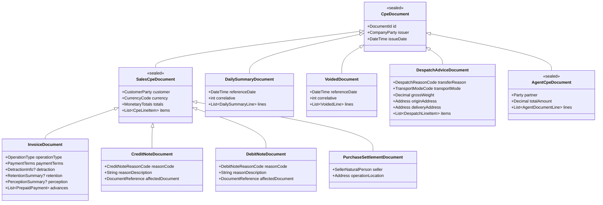

# Entidades de Dominio, Tipos de Datos y Catálogos SUNAT (`sunat_cpe_core`)

> [!NOTE] Navegación del Vault
> [[README|🏠 Índice Principal]] · **Anterior**: [[core/01_architecture_and_patterns|← 01. Arquitectura y Patrones]] · **Siguiente**: [[core/03_validation_and_ubl_signing|03. Validación y Firma UBL →]]
> **Código Fuente**: [`sunat_catalogs.dart`](../../packages/sunat_cpe_core/lib/src/catalogs/sunat_catalogs.dart) · [`cpe_entities.dart`](../../packages/sunat_cpe_core/lib/src/entities/cpe_entities.dart) · [`common_entities.dart`](../../packages/sunat_cpe_core/lib/src/entities/common_entities.dart) · [`sales_entities.dart`](../../packages/sunat_cpe_core/lib/src/entities/sales_entities.dart) · [`summary_and_voided_entities.dart`](../../packages/sunat_cpe_core/lib/src/entities/summary_and_voided_entities.dart) · [`despatch_and_agent_entities.dart`](../../packages/sunat_cpe_core/lib/src/entities/despatch_and_agent_entities.dart)

Especificación completa del modelo de dominio en **Dart 3 puro** (`sealed class` y `final class`), utilizando [`Decimal`](https://pub.dev/packages/decimal) (`package:decimal`) para todos los valores monetarios, tasas y cantidades.

---

## 1. Reglas de Tipos de Datos y Precisión

| Concepto | Tipo en Dart | Regla UBL 2.1 SUNAT / Formato |
|----------|--------------|-------------------------------|
| Montos Totales / Subtotales / Impuestos | `Decimal` | Exactamente 2 decimales al serializar (`0.00`). Validado por [[core/03_validation_and_ubl_signing#1. Motor de Validación Matemática (`CpeMathValidator`)\|`CpeMathValidator`]]. |
| Valor Unitario / Precio Unitario de Ítem | `Decimal` | Hasta 10 decimales significativos (`0.00########`). |
| Cantidad de Ítem / Peso Bruto | `Decimal` | Hasta 10 decimales en ítems; hasta 3 decimales en pesos de Guía (`KGM` / `TNE`). |
| Porcentajes / Tasas (IGV, ISC, Detracción, Retención) | `Decimal` | Ej: `Decimal.parse('18.00')`, `Decimal.parse('3.00')`. |
| Tipo de Cambio | `Decimal` | Hasta 3 o 6 decimales según proveedor (`3.754`). |
| Fechas de Emisión / Vencimiento / Traslado | `LocalDate` (o `DateTime` UTC-5) | Formato ISO `YYYY-MM-DD` (o `DD-MM-YYYY` en [[providers/01_nubefact\|Nubefact]]). |
| Hora de Emisión | `LocalTime` (o `String`) | Formato `HH:mm:ss`. |
| Identificadores y Códigos SUNAT | `enum` / `final class` | Tipado fuerte sobre [Anexo N° 8 de SUNAT](https://cpe.sunat.gob.pe/node/88) (Catálogos 01 al 65). |

---

## 2. Catálogos Oficiales SUNAT (Anexo N° 8)

Implementados en [`lib/src/catalogs/sunat_catalogs.dart`](../../packages/sunat_cpe_core/lib/src/catalogs/sunat_catalogs.dart):

```dart
/// Catálogo 01: Código de Tipo de Documento
enum CpeDocumentType {
  factura('01', 'Factura Electrónica'),
  boleta('03', 'Boleta de Venta Electrónica'),
  liquidacionCompra('04', 'Liquidación de Compra Electrónica'),
  notaCredito('07', 'Nota de Crédito Electrónica'),
  notaDebito('08', 'Nota de Débito Electrónica'),
  guiaRemisionRemitente('09', 'Guía de Remisión Remitente'),
  comprobanteRetencion('20', 'Comprobante de Retención Electrónico'),
  guiaRemisionTransportista('31', 'Guía de Remisión Transportista'),
  comprobantePercepcion('40', 'Comprobante de Percepción Electrónico'),
  resumenDiario('RC', 'Resumen Diario de Boletas'),
  comunicacionBaja('RA', 'Comunicación de Baja'),
  reversion('RR', 'Resumen de Reversiones');

  final String code;
  final String description;
  const CpeDocumentType(this.code, this.description);
}

/// Catálogo 02: Monedas (ISO 4217)
enum CurrencyCode {
  pen('PEN', 'Soles'),
  usd('USD', 'Dólares Americanos'),
  eur('EUR', 'Euros');

  final String code;
  final String name;
  const CurrencyCode(this.code, this.name);
}

/// Catálogo 06: Documento de Identidad
enum IdentityDocumentType {
  noDomiciliado('0', 'DOC.TRIB.NO.DOM.SIN.RUC'),
  dni('1', 'DNI'),
  carnetExtranjeria('4', 'Carnet de Extranjería'),
  ruc('6', 'RUC'),
  pasaporte('7', 'Pasaporte'),
  cedulaDiplomatica('A', 'Cédula Diplomática'),
  tam('G', 'Tarjeta Andina de Migración');

  final String code;
  final String description;
  const IdentityDocumentType(this.code, this.description);
}

/// Catálogo 07: Tipo de Afectación del IGV
enum IgvAffectationType {
  gravadoOperacionOnerosa('10', TaxCategoryCode.s, isFree: false),
  gravadoRetiroPremio('11', TaxCategoryCode.z, isFree: true),
  gravadoRetiroDonacion('12', TaxCategoryCode.z, isFree: true),
  gravadoRetiro('13', TaxCategoryCode.z, isFree: true),
  gravadoRetiroPublicidad('14', TaxCategoryCode.z, isFree: true),
  gravadoBonificaciones('15', TaxCategoryCode.z, isFree: true),
  gravadoRetiroEntregaTrabajadores('16', TaxCategoryCode.z, isFree: true),
  gravadoIvap('17', TaxCategoryCode.s, isFree: false), // Arroz Pilado
  exoneradoOperacionOnerosa('20', TaxCategoryCode.e, isFree: false),
  exoneradoTransferenciaGratuita('21', TaxCategoryCode.z, isFree: true),
  inafectoOperacionOnerosa('30', TaxCategoryCode.o, isFree: false),
  inafectoRetiroBonificacion('31', TaxCategoryCode.z, isFree: true),
  inafectoRetiro('32', TaxCategoryCode.z, isFree: true),
  inafectoRetiroMuestrasMedicas('33', TaxCategoryCode.z, isFree: true),
  inafectoRetiroConvenioColectivo('34', TaxCategoryCode.z, isFree: true),
  inafectoRetiroPremio('35', TaxCategoryCode.z, isFree: true),
  inafectoRetiroPublicidad('36', TaxCategoryCode.z, isFree: true),
  exportacion('40', TaxCategoryCode.g, isFree: false);

  final String code;
  final TaxCategoryCode category;
  final bool isFree;
  const IgvAffectationType(this.code, this.category, {required this.isFree});
}

/// Catálogo 05: Códigos de Tipos de Tributos
enum TaxCategoryCode {
  s('S', '1000', 'IGV', 'VAT'),
  sIvap('S', '1016', 'IVAP', 'VAT'),
  e('E', '9997', 'EXO', 'VAT'),
  o('O', '9998', 'INA', 'FRE'),
  z('Z', '9996', 'GRA', 'FRE'),
  g('G', '9995', 'EXP', 'FRE'),
  isc('S', '2000', 'ISC', 'EXC'),
  icbper('S', '7152', 'ICBPER', 'OTH');

  final String categoryId;
  final String schemeId;
  final String schemeName;
  final String taxTypeCode;
  const TaxCategoryCode(this.categoryId, this.schemeId, this.schemeName, this.taxTypeCode);
}

/// Catálogo 09: Tipo de Nota de Crédito
enum CreditNoteReasonCode {
  anulacionOperacion('01'),
  anulacionErrorRuc('02'),
  correccionErrorDescripcion('03'),
  descuentoGlobal('04'),
  descuentoPorItem('05'),
  devolucionTotal('06'),
  devolucionPorItem('07'),
  bonificacion('08'),
  disminucionValor('09'),
  otrosConceptos('10'),
  ajustesOperacionesExportacion('11'),
  ajustesAfectosIvap('12'),
  correccionMontoNetoPendientePago('13'); // Reprograma cuotas de crédito

  final String code;
  const CreditNoteReasonCode(this.code);
}

/// Catálogo 10: Tipo de Nota de Débito
enum DebitNoteReasonCode {
  interesesPorMora('01'),
  aumentoEnElValor('02'),
  penalidadesOtrosConceptos('03'),
  ajustesOperacionesExportacion('10'),
  ajustesAfectosIvap('11');

  final String code;
  const DebitNoteReasonCode(this.code);
}

/// Catálogo 51: Tipo de Operación
enum OperationType {
  ventaInterna('0101'),
  ventaInternaAnticipos('0102'),
  ventaItinerante('0103'),
  exportacionBienes('0200'),
  exportacionServiciosPais('0201'),
  operacionSujetaDetraccion('1001'),
  operacionSujetaDetraccionRecursosHidrobiologicos('1002'),
  operacionSujetaDetraccionTransportePasajeros('1003'),
  operacionSujetaDetraccionTransporteCarga('1004'),
  operacionSujetaPercepcion('2001'),
  operacionSujetaRetencion('2002');

  final String code;
  const OperationType(this.code);
}
```

---

## 3. Jerarquía de Entidades de Dominio (`CpeDocument`)



---

## 4. Definición Detallada de Entidades Principales

### 4.1 Identificación y Partes (`DocumentId`, `CompanyParty`, `CustomerParty`)

Definidas en [`common_entities.dart`](../../packages/sunat_cpe_core/lib/src/entities/common_entities.dart):

```dart
final class DocumentId {
  final String issuerRuc;            // 11 dígitos (ej. "20100066603")
  final CpeDocumentType type;        // 01, 03, 07, 08, 09, etc.
  final String series;               // 4 caracteres (F001, B001, FC01, T001) o RC-YYYYMMDD
  final int number;                  // Correlativo (1 a 99999999)

  const DocumentId({
    required this.issuerRuc,
    required this.type,
    required this.series,
    required this.number,
  });

  /// Formato estándar de archivo SUNAT: {RUC}-{TIPO}-{SERIE}-{NUMERO}
  String get fileNameBase => '$issuerRuc-${type.code}-$series-$number';
}

final class Address {
  final String? ubigeo;              // 6 dígitos INEI (ej. "150101")
  final String streetLine;           // Dirección completa
  final String? urbanization;
  final String? district;
  final String? province;
  final String? department;
  final String countryCode;          // Por defecto 'PE'
  final String? establishmentCode;   // Código anexo SUNAT (ej. "0000")

  const Address({
    this.ubigeo,
    required this.streetLine,
    this.urbanization,
    this.district,
    this.province,
    this.department,
    this.countryCode = 'PE',
    this.establishmentCode = '0000',
  });
}

final class CompanyParty {
  final String ruc;
  final String legalName;
  final String? tradeName;
  final Address address;
  final String? email;
  final String? phone;

  const CompanyParty({
    required this.ruc,
    required this.legalName,
    this.tradeName,
    required this.address,
    this.email,
    this.phone,
  });
}

final class CustomerParty {
  final IdentityDocumentType documentType;
  final String documentNumber;
  final String legalName;
  final Address? address;
  final String? email;

  const CustomerParty({
    required this.documentType,
    required this.documentNumber,
    required this.legalName,
    this.address,
    this.email,
  });
}
```

### 4.2 Totales Monetarios e Impuestos (`MonetaryTotals` - Passthrough Estricto)

Definidos en [`sales_entities.dart`](../../packages/sunat_cpe_core/lib/src/entities/sales_entities.dart):

```dart
final class MonetaryTotals {
  final Decimal totalGravadas;       // Total valor de venta operaciones gravadas (1001)
  final Decimal totalExoneradas;     // Total valor de venta operaciones exoneradas (1003)
  final Decimal totalInafectas;      // Total valor de venta operaciones inafectas (1002)
  final Decimal totalExportacion;    // Total valor de venta exportación (1004)
  final Decimal totalGratuitas;      // Total valor de venta operaciones gratuitas (1004/9996)
  final Decimal totalIvapBase;       // Base imponible arroz pilado

  final Decimal totalIgv;            // Total IGV (18% o 10% Ley 31556)
  final Decimal totalIvap;           // Total impuesto IVAP
  final Decimal totalIsc;            // Total Impuesto Selectivo al Consumo
  final Decimal totalIcbper;         // Total Impuesto Bolsas Plásticas
  final Decimal totalOtrosTributos;  // Otros tributos (9999)
  final Decimal totalImpuestosGratuitas; // IGV referencial de operaciones gratuitas

  final Decimal totalDescuentosLinea;// Suma de descuentos por ítem
  final Decimal descuentoGlobalAfectaBase;     // Descuento global que reduce base imponible (Código 02)
  final Decimal descuentoGlobalNoAfectaBase;   // Descuento global que no afecta base (Código 03)
  final Decimal totalOtrosCargos;    // Recargos al consumo / propinas
  final Decimal totalAnticipos;      // Suma de anticipos deducidos
  final Decimal redondeo;            // Ajuste de redondeo (+/- 0.00)

  final Decimal totalValorVenta;     // Suma de valores de venta sin impuestos (LineExtensionAmount)
  final Decimal totalImpuestos;      // Suma de IGV + IVAP + ISC + ICBPER + OtrosTributos (TaxAmount)
  final Decimal totalPrecioVenta;    // Total Valor Venta + Total Impuestos (TaxInclusiveAmount)
  final Decimal importeTotalPagar;   // Importe final del comprobante (PayableAmount)

  final String? amountInWords;       // Leyenda 1000: "SON CIENTO DIECIOCHO CON 00/100 SOLES"

  const MonetaryTotals({
    required this.totalGravadas,
    required this.totalExoneradas,
    required this.totalInafectas,
    required this.totalExportacion,
    required this.totalGratuitas,
    required this.totalIvapBase,
    required this.totalIgv,
    required this.totalIvap,
    required this.totalIsc,
    required this.totalIcbper,
    required this.totalOtrosTributos,
    required this.totalImpuestosGratuitas,
    required this.totalDescuentosLinea,
    required this.descuentoGlobalAfectaBase,
    required this.descuentoGlobalNoAfectaBase,
    required this.totalOtrosCargos,
    required this.totalAnticipos,
    required this.redondeo,
    required this.totalValorVenta,
    required this.totalImpuestos,
    required this.totalPrecioVenta,
    required this.importeTotalPagar,
    this.amountInWords,
  });
}
```

### 4.3 Línea de Detalle (`CpeLineItem` - Passthrough Estricto)

```dart
final class CpeLineItem {
  final int lineNumber;              // Orden correlativo (1, 2, 3...)
  final String? internalCode;        // SKU o código interno del producto
  final String? sunatProductCode;    // Catálogo 25: Código UNSPSC (8 dígitos, obligatorio en ciertos regímenes)
  final String? gtinCode;            // Código de barras GTIN
  final String unitCode;             // Catálogo 03: 'NIU' (Unidades), 'ZZ' (Servicios), 'KGM', etc.
  final String description;          // Descripción del bien o servicio
  final Decimal quantity;            // Cantidad

  /// Valor unitario SIN impuestos (o 0.00 en gratuitas)
  final Decimal unitValue;

  /// Precio unitario CON impuestos (Catálogo 16 código '01') o Valor Referencial en gratuitas (código '02')
  final Decimal unitPrice;
  final bool isReferencePrice;       // true -> código '02' (Gratuitas), false -> código '01' (Onerosas)

  /// Subtotal de la línea antes de impuestos (quantity * unitValue - discountAmount)
  final Decimal lineExtensionAmount;

  /// Base imponible sobre la cual se calcula el IGV/IVAP de la línea
  final Decimal taxableBaseAmount;

  final IgvAffectationType igvAffectation; // Catálogo 07 ('10', '20', '30', etc.)
  final Decimal igvPercentage;       // Ej: Decimal.parse('18.00') o Decimal.parse('10.00')
  final Decimal igvAmount;           // Monto IGV de la línea

  // ISC opcional
  final String? iscSystemCode;       // Catálogo 08 ('01' Al Valor, '02' Monto Fijo, '03' Precio Público)
  final Decimal? iscPercentage;
  final Decimal? iscAmount;

  // ICBPER opcional (Bolsas plásticas)
  final int? icbperQuantity;
  final Decimal? icbperUnitTax;      // Ej: Decimal.parse('0.50')
  final Decimal? icbperAmount;

  /// Descuento o cargo a nivel de ítem (Catálogo 53: '00' afecta base, '01' no afecta)
  final AllowanceCharge? discount;
  final AllowanceCharge? charge;

  /// Suma total de impuestos de la línea (igvAmount + iscAmount + icbperAmount)
  final Decimal totalLineTaxAmount;

  /// Importe total de la línea incluyendo impuestos
  final Decimal totalLineAmount;

  const CpeLineItem({
    required this.lineNumber,
    this.internalCode,
    this.sunatProductCode,
    this.gtinCode,
    required this.unitCode,
    required this.description,
    required this.quantity,
    required this.unitValue,
    required this.unitPrice,
    this.isReferencePrice = false,
    required this.lineExtensionAmount,
    required this.taxableBaseAmount,
    required this.igvAffectation,
    required this.igvPercentage,
    required this.igvAmount,
    this.iscSystemCode,
    this.iscPercentage,
    this.iscAmount,
    this.icbperQuantity,
    this.icbperUnitTax,
    this.icbperAmount,
    this.discount,
    this.charge,
    required this.totalLineTaxAmount,
    required this.totalLineAmount,
  });
}
```

### 4.4 Condiciones de Pago, Cuotas, Detracciones y Retenciones (RS 000193-2020/SUNAT)

> [!IMPORTANT] Relevancia en Factoring y Cavali
> Estas estructuras son validadas estrictamente por [[core/03_validation_and_ubl_signing#1.2 Reglas de Cuadre de Cabecera (`MonetaryTotals`)|`CpeMathValidator`]] y son obligatorias para la negociación de facturas en [[providers/09_cavali_gosocket|09. Cavali / Gosocket Factrack]].

```dart
sealed class PaymentTerms {
  const PaymentTerms();
}

/// Pago al Contado ("Contado")
final class CashPaymentTerms extends PaymentTerms {
  const CashPaymentTerms();
}

/// Pago al Crédito ("Credito") con cronograma obligatorio de cuotas
final class CreditPaymentTerms extends PaymentTerms {
  /// Monto neto pendiente de pago (Importe Total - Detracción - Retención)
  final Decimal netPendingAmount;
  final List<PaymentInstallment> installments;

  const CreditPaymentTerms({
    required this.netPendingAmount,
    required this.installments,
  });
}

final class PaymentInstallment {
  final int number;                  // Cuota001, Cuota002...
  final Decimal amount;
  final DateTime dueDate;

  const PaymentInstallment({
    required this.number,
    required this.amount,
    required this.dueDate,
  });
}

final class DetractionInfo {
  final String code;                 // Catálogo 54 (ej. '022', '037')
  final String paymentMethodCode;    // Catálogo 59 (por defecto '001' Depósito en cuenta)
  final String bankAccountNumber;    // Cuenta de detracciones Banco de la Nación
  final Decimal percentage;          // Ej: Decimal.parse('12.00')
  final Decimal amountInPen;         // Siempre en Soles (PEN), redondeado sin decimales o con 2 según regla

  const DetractionInfo({
    required this.code,
    this.paymentMethodCode = '001',
    required this.bankAccountNumber,
    required this.percentage,
    required this.amountInPen,
  });
}
```

### 4.5 Resúmenes, Bajas, Guías de Remisión, Retenciones y Percepciones

Implementados en [`summary_and_voided_entities.dart`](../../packages/sunat_cpe_core/lib/src/entities/summary_and_voided_entities.dart) y [`despatch_and_agent_entities.dart`](../../packages/sunat_cpe_core/lib/src/entities/despatch_and_agent_entities.dart):

- **`DailySummaryDocument` (`RC`)**:
  - `referenceDate`: Fecha de emisión de las boletas/notas incluidas.
  - `summaryDate`: Fecha de generación del resumen (`RC-YYYYMMDD-#####`).
  - `lines`: Lista de `DailySummaryLine` con `statusCondition` (`1` = Adicionar, `2` = Modificar, `3` = Anular), datos del receptor, documento modificado (si es NC/ND) y desglose de bases e impuestos.
- **`VoidedDocument` (`RA` / `RR`)**:
  - `referenceDate`: Fecha de emisión de los comprobantes a dar de baja.
  - `lines`: Lista de `VoidedLine` con `documentType`, `series`, `number`, y `reason` (motivo de baja).
- **`DespatchAdviceDocument` (`09` Remitente / `31` Transportista)**:
  - Soporta la nueva estructura UBL 2.1 para Guías Electrónicas (GRE):
  - `transferReason` (Catálogo 20: Venta `'01'`, Compra `'02'`, Traslado entre establecimientos `'04'`, etc.).
  - `transportMode` (Catálogo 18: Transporte Público `'01'`, Transporte Privado `'02'`).
  - `startDate`, `grossWeight`, `weightUnitCode` (`'KGM'` o `'TNE'`), `packageCount`.
  - `carrier`: RUC, Razón Social y Registro MTC (en transporte público).
  - `vehicles`: Vehículo principal y secundarios (`plateNumber`, `tucCertificateNumber`, `authorizationEntity`).
  - `drivers`: Conductores principal y secundarios (`documentType`, `documentNumber`, `firstName`, `lastName`, `licenseNumber`).
  - `originAddress` y `deliveryAddress` (con `ubigeo` y `establishmentCode` para traslado `'04'`).
  - `relatedDocuments`: Facturas, Boletas, DAM o Guías vinculadas.
- **`AgentCpeDocument` (`RetentionDocument` `20` y `PerceptionDocument` `40`)**:
  - Régimen de retención (Catálogo 23: `'01'` Tasa 3%, `'02'` Tasa 6%) o percepción (Catálogo 22: `'01'` Venta interna 2%, `'02'` Adquisición combustible 1%, `'03'` Tasa especial 0.5%).
  - Lista de comprobantes pagados/cobrados (`AgentDocumentLine`) con datos de moneda original, tipo de cambio, importe pagado e importe retenido/percibido en `PEN`.

---

> [!TIP] Continúa leyendo
> - [[README|🏠 Índice Principal]]
> - [[core/01_architecture_and_patterns|← 01. Arquitectura, Patrones e Interfaces]]
> - [[core/03_validation_and_ubl_signing|03. Validación Matemática, Motor UBL 2.1 y Firma XAdES-BES →]]
