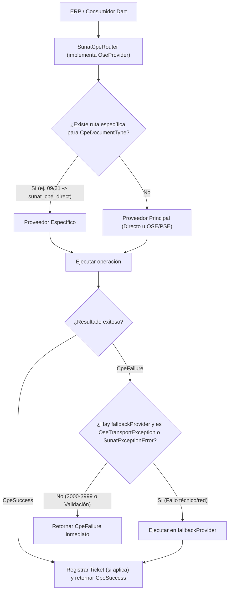

# 04. Paquete Principal y Enrutador Inteligente (`sunat_cpe_main`)

> [!NOTE] Navegación del Vault
> [[README|🏠 Índice Principal]] · **Anterior**: [[core/03_validation_and_ubl_signing|← 03. Validación, UBL 2.1 y Firma XAdES-BES]] · **Proveedor Directo**: [[providers/10_sunat_direct|10. SUNAT Directo →]]
> **Código Fuente**: [`sunat_cpe_router.dart`](../../packages/sunat_cpe_main/lib/src/sunat_cpe_router.dart) · [`sunat_cpe_router_config.dart`](../../packages/sunat_cpe_main/lib/src/sunat_cpe_router_config.dart) · [`sunat_provider_descriptor.dart`](../../packages/sunat_cpe_main/lib/src/sunat_provider_descriptor.dart) · [`sunat_provider_factory.dart`](../../packages/sunat_cpe_main/lib/src/sunat_provider_factory.dart)
> **Enlaces Externos**: [Paquete en Monorepo GitHub](https://github.com/Cesarius1970/sunat_cpe/tree/main/packages/sunat_cpe_main)

Especificación de arquitectura para `packages/sunat_cpe_main`, el paquete **Umbrella y Orquestador / Router Inteligente** que permite a cualquier aplicación o ERP en Dart discernir dinámicamente entre el envío directo a SUNAT ([[providers/10_sunat_direct|`sunat_cpe_direct`]]) y cualquiera de los 9 adaptadores OSE/PSE ([[providers/01_nubefact|Nubefact]], [[providers/02_efact|EFACT]], [[providers/03_mifact|Mifact]], [[providers/04_bizlinks|Bizlinks]], [[providers/05_digiflow|Digiflow]], [[providers/06_sovos_paperless|Sovos]], [[providers/07_facturaloperu|FacturaloPeru]], [[providers/08_tci|TCI]], [[providers/09_cavali_gosocket|Cavali]]).

---

## 1. Propósito y Patrones de Diseño en `sunat_cpe_main`

1. **Punto Único de Entrada (Umbrella Export)**:
   - Re-exporta `sunat_cpe_core`, `sunat_cpe_direct` y los 9 proveedores OSE/PSE para que el consumidor solo agregue `sunat_cpe_main` en su `pubspec.yaml` cuando necesite soporte multi-proveedor.
2. **Patrón Strategy + Content-Based Router (`SunatCpeRouter`)**:
   - Implementa la misma interfaz [[core/01_architecture_and_patterns#5. Contrato Principal `OseProvider` y Capacidades Modulares|`OseProvider`]] (transparente para el consumidor).
   - Permite definir un **proveedor por defecto** (`primaryProvider`) y un **mapa de enrutamiento por tipo de documento** (`Map<CpeDocumentType, OseProvider> routesByDocumentType`).
   - *Caso de uso real en Perú*: Emitir Facturas (`01`) y Boletas (`03`) mediante un PSE/OSE contratado (ej. [[providers/01_nubefact|Nubefact]] o [[providers/04_bizlinks|Bizlinks]]), pero enviar Guías de Remisión (`09`/`31`) directamente a la API REST gratuita de SUNAT mediante [[providers/10_sunat_direct|`sunat_cpe_direct`]].
3. **Patrón Circuit-Safe Fallback (`fallbackProvider`)**:
   - Permite configurar un proveedor de contingencia (ej. si el PSE cae por mantenimiento o error HTTP 5xx, conmutar a un OSE secundario o a `sunat_cpe_direct`).
   - **Regla de Seguridad Contable**: El fallback **solo** se activa ante errores donde el comprobante **NO** ha sido registrado:
     - `OseTransportException` (Timeouts, caídas de red, HTTP 502/503/504).
     - `SunatExceptionError` (Códigos `0100` a `1999`).
   - **Nunca** se ejecuta fallback ante `CpeValidationException` (error aritmético local) ni ante `SunatRejectionException` (códigos `2000` a `3999`, donde el comprobante ya fue rechazado formalmente).
4. **Rastreo Inteligente de Tickets Asíncronos (`TicketOriginRegistry`)**:
   - Cuando `sendDailySummary`, `sendVoidedDocument` o `sendDespatchAdvice` generan un `ticket` en un proveedor específico (ya sea por regla de tipo de documento o por ejecución de fallback), `SunatCpeRouter` registra en memoria la asociación `ticket -> providerId` y soporta además prefijos opcionales (`{providerId}:{ticket}`) o resolución por `referenceId.type`.
   - Así, cuando el consumidor invoca `checkTicket(ticket)` o `pollTicketUntilDone(ticket)`, el router dirige la consulta exactamente al proveedor que emitió ese ticket.

---

## 2. Diagrama de Flujo de Decisión (`SunatCpeRouter`)



---

## 3. Configuración Declarativa (`SunatCpeRouterConfig` y `SunatProviderDescriptor`)

Además de permitir inyectar instancias directas de `OseProvider`, `sunat_cpe_main` ofrece una fábrica declarativa (`SunatProviderFactory`) basada en una jerarquía `sealed class SunatProviderDescriptor`:

- `DirectSunatDescriptor(SunatDirectConfig config)`
- `NubefactDescriptor(NubefactConfig config)`
- `EfactDescriptor(EfactConfig config)`
- `MifactDescriptor(MifactConfig config)`
- `BizlinksDescriptor(BizlinksConfig config)`
- `DigiflowDescriptor(DigiflowConfig config)`
- `SovosDescriptor(SovosConfig config)`
- `FacturaloDescriptor(FacturaloConfig config)`
- `TciDescriptor(TciConfig config)`
- `CavaliDescriptor(CavaliConfig config)`

Esto permite instanciar `SunatCpeRouter.fromDescriptors(...)` leyendo la configuración del tenant desde base de datos o variables de entorno.

---

## 4. Diseño de Clases del Paquete `sunat_cpe_main`

```text
packages/sunat_cpe_main/
├── lib/
│   ├── sunat_cpe_main.dart               # Umbrella export (core + direct + 9 proveedores + router)
│   └── src/
│       ├── sunat_provider_descriptor.dart # Sealed class con descriptores tipados para Direct y los 9 OSE/PSE
│       ├── sunat_provider_factory.dart    # Instancia cualquier OseProvider a partir de su descriptor
│       ├── sunat_cpe_router_config.dart   # Configuración de primary, routesByDocumentType y política de fallback
│       └── sunat_cpe_router.dart          # Implementa OseProvider con enrutamiento, registro de tickets y fallback seguro
```

---

> [!TIP] Navegación
> - [[README|🏠 Índice Principal]]
> - **Anterior**: [[core/03_validation_and_ubl_signing|← 03. Validación, UBL 2.1 y Firma XAdES-BES]]
> - **Proveedor Directo**: [[providers/10_sunat_direct|10. SUNAT Directo (`sunat_cpe_direct`) →]]
